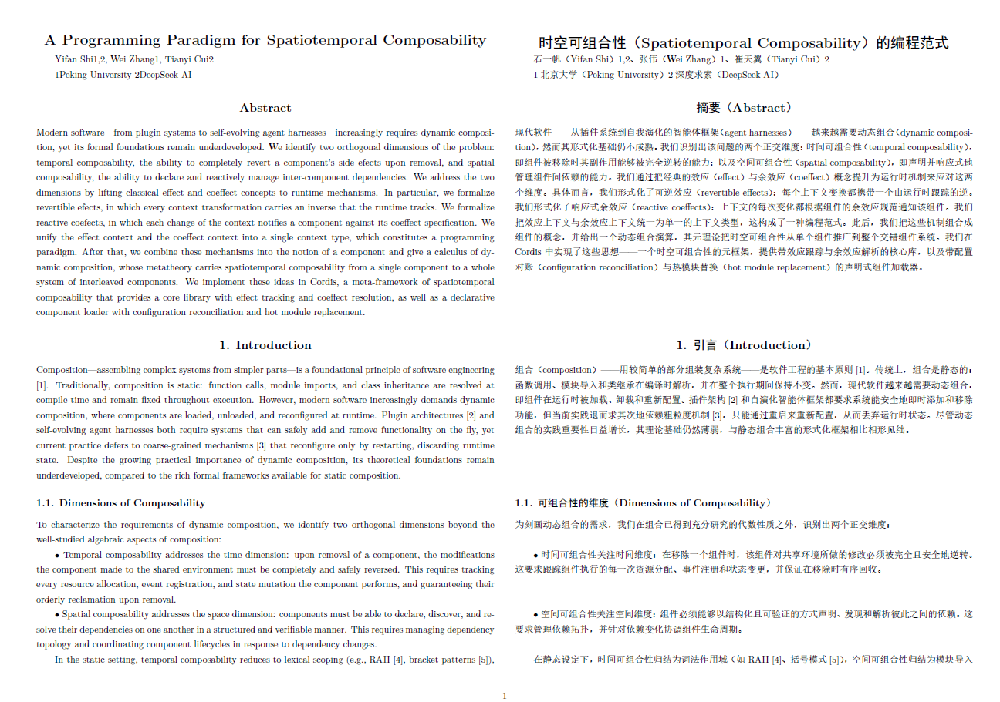

# parallel-read-papers

Translate English paper PDFs into Chinese with **4 output formats** — the highlight being a **side-by-side bilingual PDF**: the English original and Chinese translation printed in parallel columns, paragraph-aligned, for comfortable side-by-side reading.



## Four Output Formats

| Output | File | Description |
|--------|------|-------------|
| Side-by-side bilingual PDF | `<en-title>_bilingual.pdf` | ⭐ English original (left) + Chinese translation (right); each column is self-contained (title, headings, formulas, figures, tables in its own language), paragraph starts aligned — the longer column sets the position, the shorter waits |
| Chinese single-column PDF | `<zh-title>_single.pdf` | Pure Chinese, restores the original single-column layout (equation numbers preserved) |
| Chinese Markdown | `<zh-title>_zh.md` | Paragraph-by-paragraph Chinese translation |
| Bilingual Markdown | `<en-title>_bilingual.md` | EN/CN two-column table for lightweight reading/editing |

> Naming: English-related outputs (bilingual PDF, bilingual Markdown) use the **English title** slug; Chinese-related outputs (Chinese Markdown, single-column PDF) use the **Chinese title** slug (e.g. `a-programming-paradigm-for-spatiotemporal-composability_bilingual.pdf`, `时空可组合性-spatiotemporal-composability-的编程范式_zh.md`); falls back to the input filename when extraction fails.

## The Side-by-Side PDF (Core Feature)

- **Each column is self-contained**: left = complete English original (title, authors, section headings, body, equations, figures, tables); right = complete Chinese translation of everything
- **Paragraph-aligned**: every EN/CN paragraph pair starts at the same height; when one side is longer, the other leaves blank space and waits — first lines always align
- **Formulas & figures per language**: equations show the same `\tag{n}` number on both sides; figures/tables are typeset independently in each column

## Examples

The `example/` directory ships the 4-formatted outputs of two real papers — open the bilingual PDF to see it in action:
- `a-programming-paradigm-for-spatiotemporal-composability_bilingual.pdf`
- `fire-flyer-ai-hpc-a-cost-effective-software-hardware-co-design-for-deep-learning_bilingual.pdf`

Release artifacts live in `output/`; process files (MinerU parse, translation draft, build intermediates) in `work/<paper-slug>/`; source PDFs in `input/`.

## Install

```bash
pip install -r requirements.txt   # requests, python-dotenv, pytest
```
Dependencies: Python 3.10+, [pandoc](https://pandoc.org), TeX Live (**lualatex** + ctex + paracol for the bilingual PDF; xelatex + ctex for single-column), Chinese fonts (SimSun/SimHei ship with Windows).

## Usage

### 1. Parse (optional)
An English PDF must first be converted to Markdown. Set `MINERU_API_TOKEN` in `config/.env` (https://mineru.net/apiManage/token), then:

```bash
python -m scripts.run --source <paper.pdf> --outputs zh_md
```

If you already have MinerU output (a directory with `full.md` + `images/`), point `--source` at that directory directly.

### 2. Translate
Following `SKILL.md`, translate `full.md` paragraph-by-paragraph into `full_zh.md` (keep formulas/images/tables intact, unify terminology, keep References in English).

### 3. Generate the 4 outputs
```bash
# ① generate into the process dir work/<paper-slug>/ (artifacts + build intermediates)
python -m scripts.run --source <dir-or-pdf> --outputs zh_md,bilingual_pdf,single_pdf,bilingual_md --out-dir work/<paper-slug>
# ② publish the 4 artifacts to output/ (release) and example/ (demo)
copy work/<paper-slug>/*_zh.md work/<paper-slug>/*_single.pdf work/<paper-slug>/*_bilingual.pdf work/<paper-slug>/*_bilingual.md output\ example\
```
The first three are generated by default; add `bilingual_md` explicitly for the bilingual Markdown.

### 4. Validate
```bash
python -m scripts.validate full.md full_zh.md --image-dir <dir>
```
FAIL items must be 0 (formula closure, HTML tags, garbled chars, image consistency); WARN items are for human review.

## Repository Layout

```
parallel-read-papers/
├── SKILL.md                  # methodology (5-stage workflow, glossary, known-pitfalls)
├── README.md / README.en.md
├── output/                   # release: 4-format artifacts (PDF/MD only)
├── work/                     # process files, per <paper-slug>/ (not committed)
├── example/                  # demo: 4-format outputs of two papers + preview image
├── input/                    # source paper PDFs (not committed; see arXiv links in README)
├── config/.env.example       # MINERU_API_TOKEN template
├── scripts/                  # run / mineru_convert / validate / make_single / make_bilingual* / copy_images
├── templates/                # single.tex (single-column), bilingual.tex (paracol side-by-side)
└── tests/                    # pytest unit tests (29+)
```

## License

MIT License
