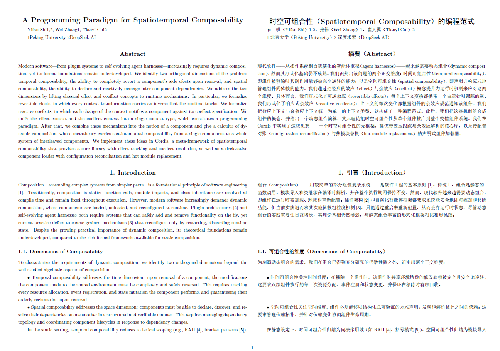

# parallel-read-papers

把英文论文 PDF 翻译成中文，一键输出 **4 种格式**——重点是**对开双栏中英对照 PDF**：左右两页并排，左栏英文原文、右栏中文译文，逐段对齐，方便对照阅读。

## 四态输出

| 输出 | 文件 | 说明 |
|------|------|------|
| 对开双栏中英对照 PDF | `<英文标题>_bilingual.pdf` | ⭐ 左英文原文、右中文译文，两栏各自完整（标题/章节/公式/图/表各归各语言），段落首行对齐、互相等待 |
| 中文单栏还原 PDF | `<中文标题>_single.pdf` | 纯中文，还原原论文单栏排版（公式编号保留） |
| 纯中文 Markdown | `<中文标题>_zh.md` | 逐段翻译的中文 md |
| 对照版 Markdown | `<英文标题>_bilingual.md` | 左英右中两列表格对照版 |

> 输出文件命名：英文相关输出（对开双栏 PDF、对照版 md）取**英文论文标题** slug，
> 中文相关输出（中文 md、单栏 PDF）取**中文标题** slug（如
> `a-programming-paradigm-for-spatiotemporal-composability_bilingual.pdf`、
> `时空可组合性-spatiotemporal-composability-的编程范式_zh.md`）；提取失败时回退为输入文件名。

## 对开双栏对照（核心特性）



- **两栏各自完整**：左栏 = 英文原文（标题、作者、章节标题、正文、公式、图、表全都有）；右栏 = 中文译文（全部对应翻译）
- **逐段对齐**：每一对中英段落从同一高度开始；英文长的段落中文栏留白等待，反之亦然
- **公式/图表各归各语言**：公式左右同号（`\tag{n}` 一致）、图表每栏独立排版

## 示例

`example/` 目录内置了一篇真实论文的完整示例（输入 + 四态输出），可直接打开对照版 PDF 体验效果：
- 输入：`input_full.md`（英文原文 md）
- 输出：`a-programming-paradigm-for-spatiotemporal-composability_bilingual.pdf` 等 4 个文件

## 安装

```bash
pip install -r requirements.txt   # requests、python-dotenv、pytest
```
依赖：Python 3.10+、[pandoc](https://pandoc.org)、TeX Live（对开双栏用 **lualatex** + ctex + paracol；单栏用 xelatex + ctex）、中文字体（Windows 自带 SimSun/SimHei）。

## 使用

### 1. 解析（可选）
英文 PDF 需要先解析为 Markdown。配置 `config/.env` 的 `MINERU_API_TOKEN`（https://mineru.net/apiManage/token）后：

```bash
python -m scripts.run --source <paper.pdf> --outputs zh_md
```

已有 MinerU 解析产物（含 `full.md` + `images/`）时可直接用本地目录。

### 2. 翻译
按 `SKILL.md` 流程，把 `full.md` 逐段翻译为 `full_zh.md`（公式/图片/表格保留，术语统一，References 保留英文）。

### 3. 生成四态输出
```bash
python -m scripts.run --source <目录或PDF> --outputs zh_md,bilingual_pdf,single_pdf,bilingual_md --out-dir example
```
默认输出前三种；对照版 md 需显式加入 `bilingual_md`。

### 4. 校验
```bash
python -m scripts.validate full.md full_zh.md --image-dir <目录>
```
FAIL 项必须为 0（公式闭合、HTML 标签、乱码、图片一致性）；WARN 项由人工复核。

## 目录结构

```
parallel-read-papers/
├── SKILL.md                  # 方法论（5 阶段工作流、术语表、踩坑记录）
├── README.md / README.en.md
├── config/.env.example       # MINERU_API_TOKEN 模板
├── scripts/                  # run / mineru_convert / validate / make_single / make_bilingual* / copy_images
├── templates/                # single.tex（单栏）、bilingual.tex（对开双栏 paracol）
├── tests/                    # pytest 单测（29+ 项）
└── example/                  # 真实论文示例：输入 + 四态输出
```

## 许可

MIT License
